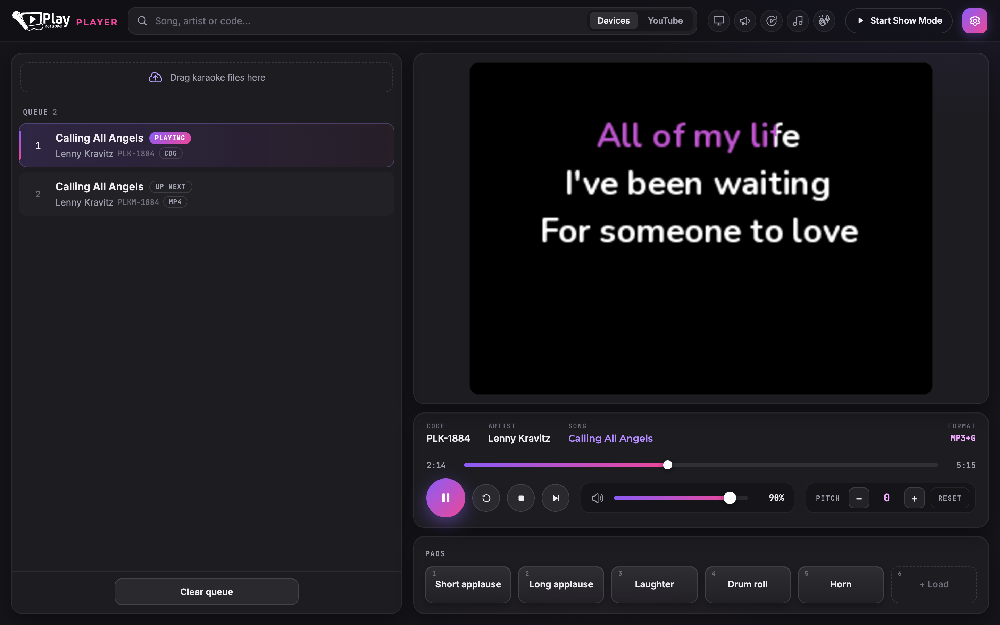
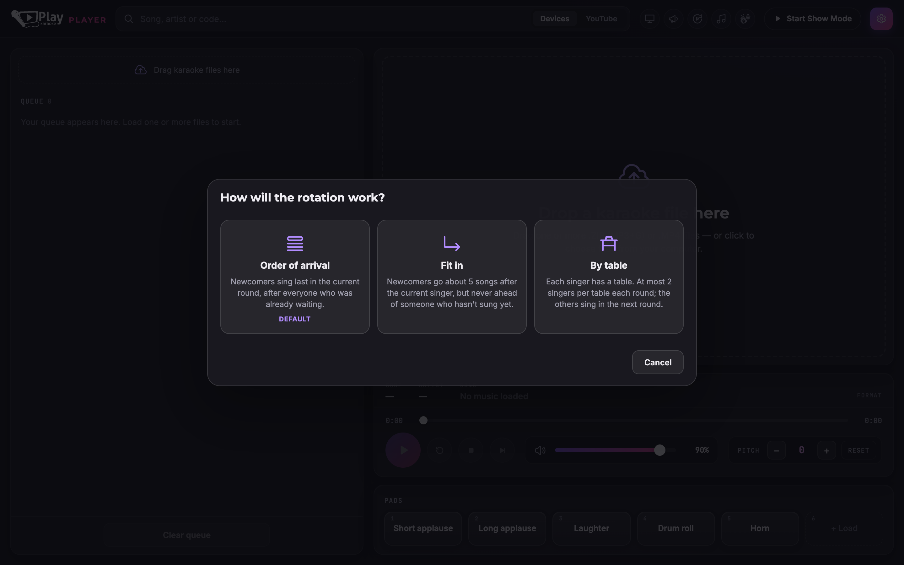
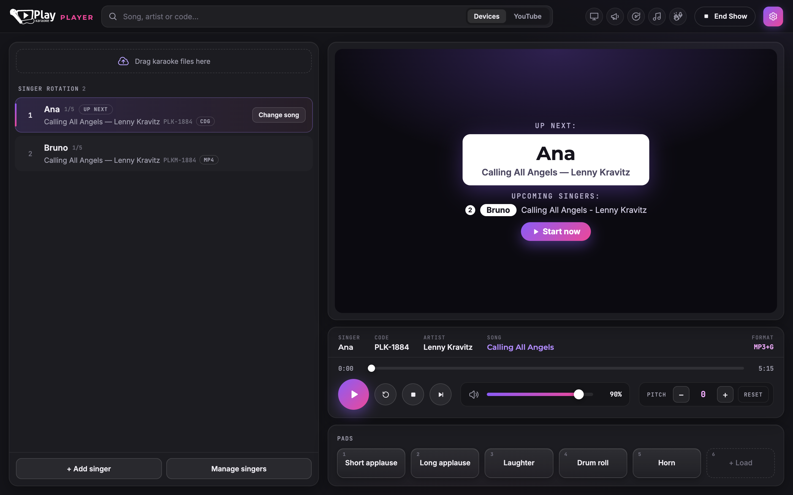
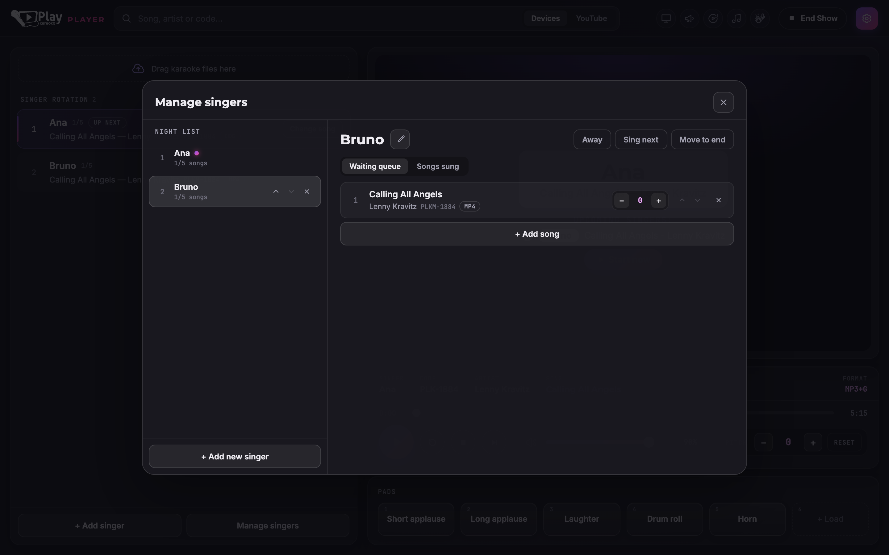
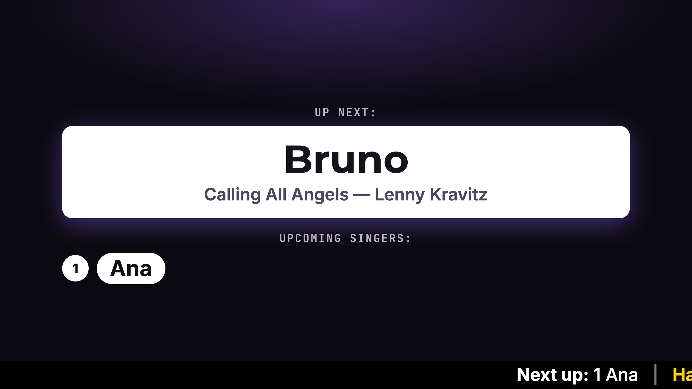
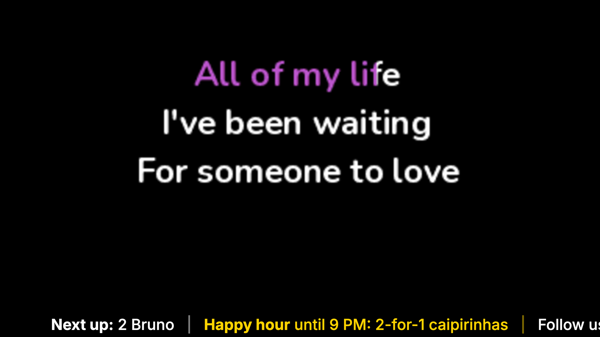
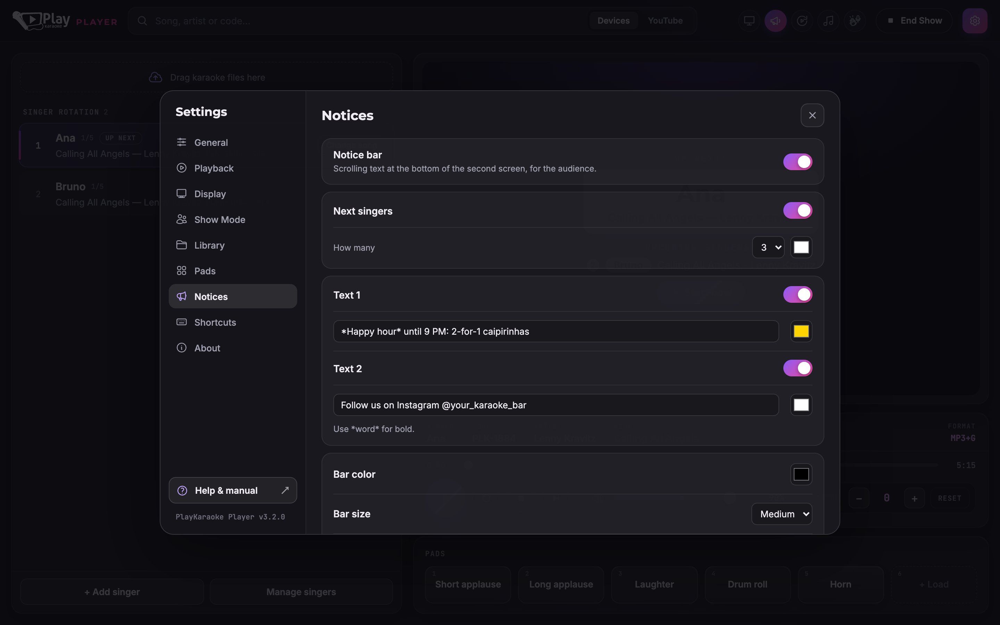
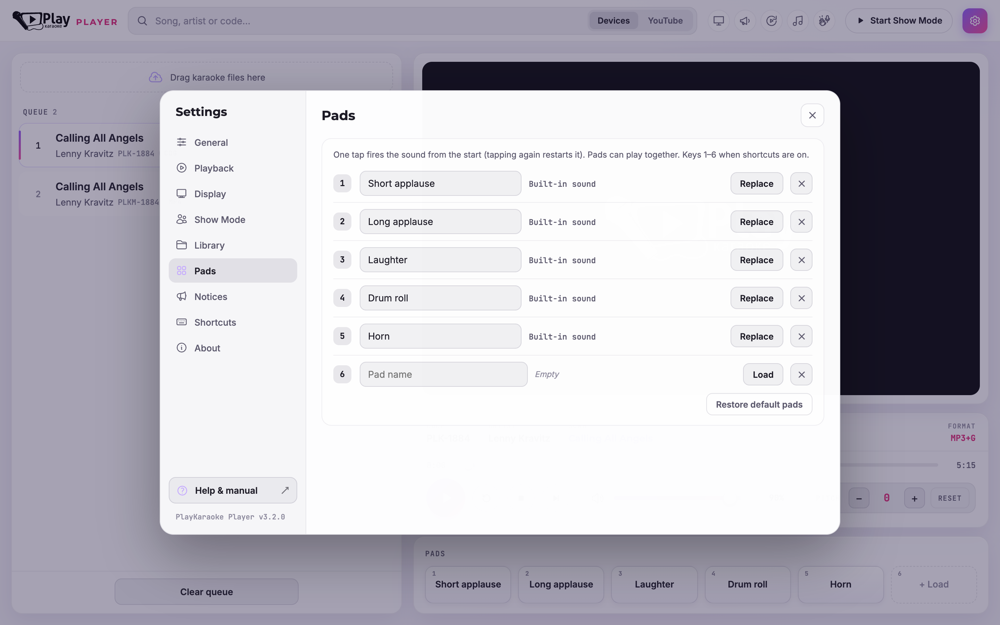

<p align="center">
  
</p>

<h1 align="center">PlayKaraoke Player</h1>

<p align="center">
  <b>A browser-based karaoke player built for the host of a real karaoke night.</b>
</p>

<p align="center">
  CDG (MP3+G) and MP4 · real-time key change · singer rotation · a second screen with a scrolling notice bar · YouTube search · sound pads.<br/>
  No install, no server: it runs 100% in the browser.
</p>

<p align="center">
  <a href="https://github.com/playkaraoke/PlayKaraokeWebPlayer/releases"></a>
  
  
  
  
</p>

<p align="center">
  <a href="https://playkaraoke.github.io/PlayKaraokeWebPlayer/"><b>▶ Open the player</b></a> ·
  <a href="https://playkaraoke.github.io/PlayKaraokeWebPlayer/help.html">Help &amp; manual</a> ·
  <a href="docs/USER_MANUAL.md">User manual (Markdown)</a> ·
  <a href="https://github.com/playkaraoke/PlayKaraokeWebPlayer/releases">Releases</a>
</p>

<br>

<p align="center">
  
  <br><sub><b>The main screen</b>: queue, live preview, controls, key change and six sound pads</sub>
</p>

<p align="center">
  <a href="#a-look-around">A look around</a> ·
  <a href="#why-playkaraoke-player">Why PlayKaraoke Player</a> ·
  <a href="#what-it-does">What it does</a> ·
  <a href="#quick-start">Quick start</a> ·
  <a href="#keyboard-shortcuts">Shortcuts</a> ·
  <a href="#browser-support">Browser support</a> ·
  <a href="#license">License</a>
</p>

## A look around

<table>
<tr>
<td width="50%" valign="top">
  
  <p align="center"><sub><b>Rotation types</b>: pick how newcomers join the night, when Show Mode starts</sub></p>
</td>
<td width="50%" valign="top">
  
  <p align="center"><sub><b>Show Mode</b>: a rotation of singers, each with up to 5 songs, and a waiting screen between turns</sub></p>
</td>
</tr>
<tr>
<td width="50%" valign="top">
  
  <p align="center"><sub><b>Manage singers</b>: reorder, rename, mark someone as Away, set each song's key</sub></p>
</td>
<td width="50%" valign="top">
  
  <p align="center"><sub><b>Second screen, waiting</b>: sized for a big TV, with the notice bar at the bottom</sub></p>
</td>
</tr>
<tr>
<td width="50%" valign="top">
  
  <p align="center"><sub><b>Notice bar</b>: who sings next and your own messages, scrolling during the song</sub></p>
</td>
<td width="50%" valign="top">
  
  <p align="center"><sub><b>Settings › Notices</b>: next singers, two free texts, colors, size and speed</sub></p>
</td>
</tr>
<tr>
<td width="50%" valign="top">
  
  <p align="center"><sub><b>English and Portuguese (Brazil)</b>: the second screen follows the language</sub></p>
</td>
<td width="50%" valign="top">
  
  <p align="center"><sub><b>Light and dark themes</b>, and pads with your own sounds</sub></p>
</td>
</tr>
</table>

## Why PlayKaraoke Player

- **Made for a real night.** The next song is always preloaded and waits paused, ready to go. **Stop** always resets the player if anything gets stuck, and keyboard shortcuts are off by default so a bump can't disrupt the show.
- **Nothing to install.** Open the page and drop your files. It runs 100% in the browser, and **your files stay on your computer**: they are read locally and never uploaded.
- **A host's tool, not just a player.** Singer rotation, last-minute song changes, an end-of-night report and a notice bar for the audience, all in one screen.
- **Your whole collection, searchable.** Index an external drive once and search by title, artist or code, ignoring case and accents. Or search YouTube.
- **Light on the machine.** While the second screen is open it becomes the main video player, halving the work on the operator's computer. A performance mode helps older computers.
- **Bilingual.** English and Portuguese (Brazil), including the built-in manual and the second screen.

## What it does

### Play

| | |
|---|---|
| **Formats** | `.zip` with `.cdg` + audio (MP3+G) and `.mp4` video |
| **Key change** | ±12 semitones in real time, without changing speed, for CDG **and** MP4 |
| **Queue** | Drop files anywhere, drag to reorder, set a key in advance per song, autoplay with a countdown, restart button |
| **Search** | One search box for your **devices** (local folders or external drives, instant) and **YouTube** |
| **Pads** | Six sound-effect buttons (applause, laughter, drum roll, horn…), with your own sounds and names |
| **Atmosphere** | Automatic applause at the end of each song, ambient music between performances (included tracks or your own folder), a custom idle image |

### Host a night: Show Mode

Show Mode turns the queue into a **rotation of singers**, each with up to 5 songs. The turn moves to the next singer on its own.

- **Choose the [rotation type](#rotation-types)** when you start: order of arrival, fit in, or by table.
- **Searchable singer picker.** Add music as usual and you are asked who it is for. Type a new name to create the singer.
- **Change song** for the singer whose turn it is, before they start or mid-song (the song they gave up on doesn't count as sung).
- **Manage singers:** add, rename, reorder or remove singers, mark someone **Away** (their turn is skipped until they're back), or send them **Sing next** or **Move to end**.
- **End performance** early or **Skip turn**, each with a confirmation.
- **End-of-night report** with total duration, songs sung, singers, the highlight of the night and a full timeline. Export it as **CSV**.

### The second screen and the notice bar

A controls-free window for a TV or projector, with lyrics, video, the countdown, the next singers and an idle image. It stays in sync with the operator's screen. The [notice bar](#notice-bar) scrolls at its bottom.

### Everything else

| | |
|---|---|
| **Comfort** | Dark and light themes, optional keyboard shortcuts, performance mode for older computers |
| **Languages** | English and Portuguese (Brazil) |
| **Help** | A full guide inside the app (**Settings › Help & manual**) and the [user manual](docs/USER_MANUAL.md) |

## Quick start

1. Open **https://playkaraoke.github.io/PlayKaraokeWebPlayer/** in Chrome or Edge.
2. Drop karaoke files anywhere on the screen (or click the drop area) and press **Play**.
3. Optional: click **Second Screen** and drag the new window to your TV or projector.
4. Hosting a night with several singers? Click **Start Show Mode** and choose how the rotation works (see [Rotation types](#rotation-types)).
5. Want the audience to read your promotions or who is up next? Turn on the notice bar (see [Notice bar](#notice-bar)).
6. To search your karaoke drive, connect it once in **Settings › Library**.

Full walkthrough: **Settings › Help & manual** in the app, or the [user manual](docs/USER_MANUAL.md).

## Rotation types

When you start Show Mode, the player asks **how the rotation will work**. This decides where a newcomer goes in the list:

| Type | How it works |
|---|---|
| **Order of arrival** (default) | Newcomers sing last in the current round, after everyone who was already waiting. |
| **Fit in** | Newcomers go about 5 songs after the current singer, but never ahead of someone who hasn't sung yet. |
| **By table** | Each singer has a table. At most 2 singers per table each round; the others sing in the next round. |

You can change it later in **Settings › Show Mode › Rotation type**. Changing it doesn't move anyone who is already in the list. Reordering by hand is always possible: drag a singer, or click the number and type a new position.

## Notice bar

A thin bar that scrolls right to left at the bottom of the **second screen**, so the audience can read it during the show. It appears only on the second screen; the operator's screen stays untouched.

- **Next singers:** position and name of the next 1 to 5 singers (needs Show Mode and a queue).
- **Text 1 and Text 2:** free texts, such as a promotion or your Instagram. Wrap a word in asterisks to make it **bold**: `*Happy hour* until 9 PM`.
- **Looks:** a color for each item, plus bar color, size (small, medium, large) and scroll speed.

Turn it on or off with the megaphone button at the top of the player (hover for its name), and set everything up in **Settings › Notices**.

## Keyboard shortcuts

Off by default; turn them on in **Settings › Shortcuts**. They never fire while typing or with a window open.

| Action | Mac | Windows |
|---|---|---|
| Play / pause | `Space` | `Space` |
| Restart song | `⌘ ←` | `Ctrl ←` |
| Next song / end performance | `⌘ →` | `Ctrl →` |
| Stop | `⌘ .` | `Ctrl .` |
| Pitch up / down / reset | `⌘ ↑` `⌘ ↓` `⌘ 0` | `Ctrl ↑` `Ctrl ↓` `Ctrl 0` |
| Volume up / down | `⌘ ⇧ ↑` `⌘ ⇧ ↓` | `Ctrl ⇧ ↑` `Ctrl ⇧ ↓` |
| Pads 1–6 | `1`…`6` | `1`…`6` |
| Search | `/` | `/` |

## Browser support

| Feature | Chrome / Edge / Opera | Safari | Firefox |
|---|:-:|:-:|:-:|
| Playback, queue, Show Mode, second screen, pads | ✅ | ✅ | ✅ |
| Key change on MP4 | ✅ | ⚠️ | ⚠️ |
| Device search (local folders) | ✅ | ❌ | ❌ |
| YouTube search | ✅ | ✅ | ✅ |

⚠️ depends on the browser version. If it's unavailable, the video plays normally and the pitch buttons say so.
**Chrome or Edge is recommended.** Device search relies on the File System Access API, which only Chromium-based browsers support.

## File naming

Song info is read from the file name, using the format `Code - Artist - Title`:

```
EJBg-0020 - Kansas - Play the Game Tonight.zip   → code, artist, title
Queen - Bohemian Rhapsody.mp4                     → artist, title
```

## Good to know

- **Your files stay on your computer.** They are read locally and never uploaded. Only YouTube searches and videos go over the internet. Queue, singers, pads and settings are saved in your browser only, so they don't sync between devices.
- **Surviving a page reload:** songs from connected folders and YouTube are restored automatically. Files added by drag & drop or the file picker can't be reopened by the browser after a reload and have to be added again.
- **YouTube songs have no key change**, because YouTube doesn't let the app access the audio. Ads may appear, and there is a daily limit on new online searches.

## Support

PlayKaraoke Player is free. If it makes your nights better, you can [buy me a coffee](https://www.paypal.com/donate/?business=jorge.domecildes%40gmail.com&no_recurring=0&item_name=Support+PlayKaraoke). More from PlayKaraoke on [YouTube](https://www.youtube.com/@playkaraoke).

## License

© 2015–2026 Jorge Domecildes · PlayKaraoke. Licensed under [PolyForm Noncommercial 1.0.0](LICENSE): personal, noncommercial use only. Copying, redistributing or reusing this code in commercial products is not permitted without written authorization.
